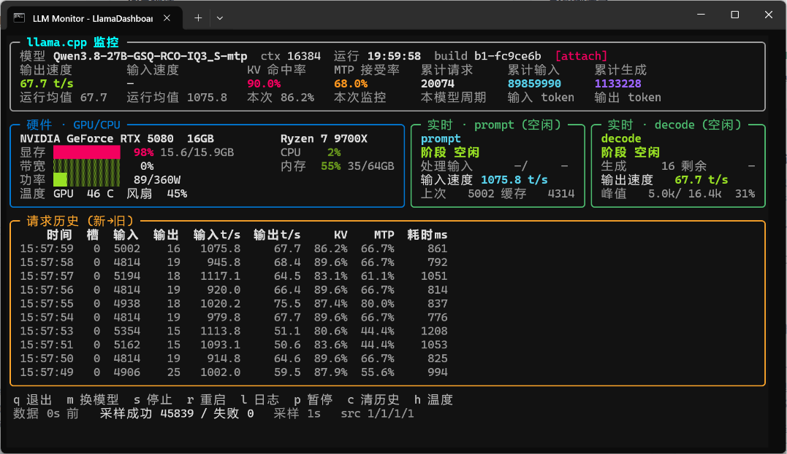

# LLM-Monitor_LlamaDashboard
地址：https://github.com/elnfnoosm/LLM-Monitor_LlamaDashboard

## 主要功能：
一个看本地大模型运行状态的小窗口：

-模型名称、模型KV大小、运行时间等

-平均及单次任务的输入/输出token速度、KV命中率、MTP接受率、累计总量、请求历史等

-GPU显存、功耗、温度、风扇，CPU及内存占用等

-自动识别 Strata和LM studio、 llama.cpp，启动谁就监控谁，不用改任何配置

## 核心优化特点：
无需复杂设置，自动识别匹配
支持 Strata、LM studio、 llama.cpp等
重点优化界面显示效果
监控开启和退出对模型服务零影响，不改你的任何启动脚本和配置

## 使用方法

1. 放在任意文件夹。 双击文件夹里的 **`运行本文件安装环境（以后双击启动监控）.bat`**，（本机需安装有 Python 3.12+，记得安装时勾选 **Add python.exe to PATH**；）
2. 以后每次使用，只需双击 `启动监控.bat`
不想用了，整个文件夹删除即可。

## 运行环境

- Windows 10 / 11
- Python **3.12 或更高版本**
- NVIDIA 显卡（显存、温度、功率等显卡数据通过 NVML 读取；没有 N 卡也能运行，只是显卡框不显示数据，其他显卡因本人没卡，暂时没加进去）

## 其他按键（一般用不上不用管）

| 键 | 作用 |
|---|---|
| `q` | 退出监控（不影响模型服务） |
| `l` | 打开模型服务运行日志浮层（Strata / LM Studio / llama.cpp 三种方式都能看；LM Studio 重启换了新日志文件会自动跟随），再按 `l` 或 `Esc` 返回 |
| `h` | 展开 / 收起硬件详情（GPU 频率、显存温度、热点温度等），再按一次收起 |
| `p` | 暂停 / 恢复采样刷新 |
| `c` | 清空本次监控的统计与历史表（不动模型服务的日志文件） |

> 底部还显示 `m` / `s` / `r` 三个键，那是为"直接用 llama.cpp 启动脚本"场景保留的高级控制
> （换模型 / 停止 / 重启，都有确认弹窗、默认取消）。用自动识别方式时完全用不到，忽略即可。

## 常见问题

**窗口显示找不到服务？** 先确认模型服务已经启动，再双击启动监控。Strata 默认端口 8080，端口换了也没关系，程序自动读取。

**有些格子一直显示 `—`？** 表示该信息在当前环境取不到（硬件不支持、或这个模型服务不提供），不影响其他数据。

**文件夹可以移动或改名吗？** 可以，两个 bat 都用相对路径，放到 U 盘、任意目录都能正常工作。

**换电脑怎么迁移？** 删掉 `app\.venv` 文件夹（本机专用运行环境），在新电脑装好 Python 后重新双击安装 bat 即可。

## 致谢

本项目基于 [tcw-znjt/LlamaDashboard](https://github.com/tcw-znjt/LlamaDashboard)（MIT License）二次开发，
原项目许可协议保留在 [LICENSE](LICENSE)。
